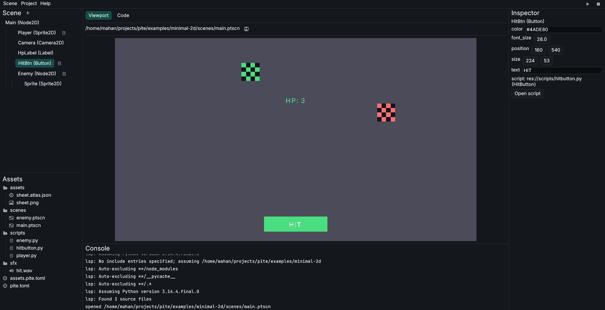

<p align="center">
  
</p>

# Pite

Pite - A game engine that's handy to use, to change, to own. Rust core, Python scripting, visual editor.

Build games from scenes and nodes (not ECS) - edit visually, script in Python.

<p align="center">
  
  <br/>
  <em>The Pite editor running the "Gem Collector" example</em>
</p>

## Quickstart

Install the engine bundle (engine + player binaries for all platforms, so any machine
exports for any platform) — latest stable, verified on download:

Linux / macOS Terminal:

```sh
curl -fsSL https://raw.githubusercontent.com/piteengine/pite/main/install.sh | sh
```

Windows PowerShell:

```powershell
irm https://raw.githubusercontent.com/piteengine/pite/main/install.ps1 | iex
```

Or install with `cargo`:

```sh
cargo install pite
```

Then:

```sh
# Create a new project (blank by default, or pass --template minimal-2d)
pite new hello

# Enter the project and launch the visual editor (or run `pite edit`)
cd hello
pite

# Run the game (defaults to main_scene, or pass a scene path)
pite run

# Validate assets, scripts, and scenes (add --reimport-assets to sync moved files)
pite check
```

Install once, then use `pite`. Running plain `pite` inside a project opens the visual editor. `new` scaffolds a project (blank or templated), `run` plays a scene (defaults to the project's main scene), `edit` opens the visual editor, `check` validates project integrity (`--reimport-assets` syncs moved assets and hashes), `toolchain` manages standalone runtimes for offline export, and `vendor` pins third-party Python packages. Building from source instead: `cargo build --release -p pite -p pite-player` (needs CPython 3.12 dev headers, see `CONTRIBUTING.md`).

### Export & Toolchains

```sh
# Pre-cache toolchains (CPython + player binaries) for offline export
pite toolchain download

# Export a standalone game for any platform
pite export linux
```

`export linux|windows|macos` writes a runnable directory (`dist/<name>-<platform>/`) with the lean player binary (no editor), a launcher script, a manual for how to run, and only the referenced game content. Provides `[export] include` in `pite.toml` for extra files, plus `vendor/` for third-party Python packages. The player is resolved as `--binary`, else a `pite-player` sibling of `pite` — engine bundles ship player binaries for all platforms, so any machine exports for any platform with no download and no compiler. When a player sibling is absent, export falls back to downloading and caching the platform's player template into `~/.cache/pite/toolchains`. Use `pite toolchain status|download|verify|clean` to manage these toolchain artifacts.

Python is bundled: export fetches a pinned CPython 3.12 (checksum-verified, cached under `~/.cache/pite/toolchains`) and ships in the exported game. The exported game runs with no system Python installed. Passing `--no-bundle-python` falls back to end-user's system Python 3.12 (`PITE_PYTHON` overrides detection).

## Why it's built this way

Pite is designed around deliberate architectural choices that prioritize developer ergonomics, reliability, and fast iteration:

### Python for scripting

Gameplay scripting is primarily about decision-making, game flow, and rapid iteration rather than raw numeric compute. Python provides an expressive, approachable syntax with an immense ecosystem, making gameplay logic intuitive to write and delightful to read.

### Rust at the core

Games demand predictable frame times, memory safety, and native execution speed. Pite builds its engine core in Rust: 2D rendering, physics simulation, scene graph traversal, and asset decoding all execute with native performance and concurrency safety, leaving Python free to orchestrate gameplay without performance bottlenecks.

### Scene Tree model and visual editor

A smooth development workflow requires immediate visual feedback. The Pite editor integrates scene hierarchy, property inspection, asset management, and live gameplay preview into a single focused workspace. The Scene Tree model (scenes and nodes) represents game worlds naturally: parent transforms cascade cleanly down the tree, and scenes compose modularly as reusable branches.

### `pite check` static verification

As games grow to hundreds of assets and scripts, broken references and missing files can easily slip in. `pite check` verifies project integrity in milliseconds: it detects orphan assets, resolves file moves via content-addressed UIDs, validates texture and audio decoding, checks script node references, and warns on third-party imports that standalone exports would drop.

### Human-readable TOML scenes

Storing scenes in human-readable TOML (`.ptscn`) makes version control natural and git diffs clean and reviewable. Merge conflicts are straightforward to resolve, scenes can be edited in any text editor, and runtime loading remains instantaneous thanks to automatic, content-hashed binary caching.

### Why Pite instead of other game engines?

- **Godot:** Pite is not trying to replace Godot. If Godot fits your workflow, use Godot. Pite exists for developers who prefer standard Python over GDScript, value lean standalone exports (~20–30 MB rather than 70+ MB), and desire a lightweight, focused 2D toolset without unnecessary complexity.
- **Bevy:** Bevy provides an outstanding Entity Component System (ECS) architecture for developers writing games purely in Rust without an editor. Pite is designed for developers who want to write games in Python with a hierarchical Scene Tree and an integrated visual editor.
- **Pygame and LÖVE:** Pygame and LÖVE are excellent, mature frameworks with passionate communities. They provide a window, input loop, and drawing primitives. Pite complements code with an integrated visual editor, a declarative scene tree, built-in 2D physics and audio mixing, resilient asset tracking, and zero-configuration standalone desktop export.

Pite is built to be handy to use, to change, and to own. It unites Python scripting and Rust performance to deliver a focused, thoughtful developer experience.

### Thoughtful defaults

- **Missing audio hardware?** Automatic silent simulation keeps the game running without crashing.
- **Script modified?** Live hot reload preserves node state and physics velocities.
- **Typing code?** Built-in pyright provides instant autocomplete, hover docs, and diagnostics.
- **Asset moved or renamed?** Content-addressed UIDs keep references intact across scenes and scripts.
- **Sharing your game?** One-command export produces a self-contained bundle with no Python installation required on the player's machine.

## Scope and focus

- **Focused on 2D desktop:** Pite is dedicated strictly to 2D games on Linux, Windows, and macOS. 3D, mobile, and web targets are outside its current scope.
- **Active development:** Pite is in the 0.x release series. Core APIs and file formats are stable and tested, with continuous refinements to features and tooling.

## Who Pite is for

- Python developers who want a dedicated 2D game engine using standard Python.
- Solo developers and indie teams looking for an integrated visual editor rather than a code-only framework.
- Educators seeking to teach game development with an accessible, industry-standard language.
- Anyone who wants to understand and inspect their engine's complete architecture from top to bottom.

## Status

**v0.3 is out:**

- 2D physics subsystem powered by Rapier2D: StaticBody2D, CharacterBody2D (with `move_and_slide`), RigidBody2D, Area2D triggers, CollisionShape2D (`box`, `circle`, `capsule`), and raycasting
- Python API redesign: `Vec2` math class with tuple unpacking, direct handle mutations, attribute-based input (`pite.held.<key>`, `pite.pressed.<key>`), declarative node descriptors (`pite.child`, `pite.node`), proxy caching, and hybrid signal callbacks
- Hot reload reliability: continuous editor idle reload, scene reload isolation, Python state and physics velocity preservation, and asset cache invalidation
- Audio support expanded: pure-Rust Symphonia decoding for Ogg Vorbis, MP3, FLAC, and multi-format WAV
- Scene extension `.ptscn` (was `.pitescene`)
- Automatic player download fallback for `pite export` with standalone and multi-platform release archives
- MacOS cross-compilation and export support

**Previous:** v0.2.0 (vendor dependencies, window scaling, editor gutter and completion), v0.1.1 (`Timer.timeout`), v0.1.0 (crates.io), and earlier milestones — see [`docs/changelog.md`](docs/changelog.md).

## Workspace

| Crate | Role |
| ----- | ---- |
| `pite` | `pite` binary: new / run / check / edit / export / vendor / toolchain (in `crates/pite-cli/`) |
| `pite-player` | Lean export player: runs a scene, no editor |
| `pite-runtime` | Window, main loop, script driving, hot reload |
| `pite-core` | Node tree, handles, props, lifecycle dispatch |
| `pite-physics` | Pure-Rust 2D physics subsystem (`rapier2d`): rigid bodies, character controller, triggers, raycasts |
| `pite-render` | `Renderer2D` trait (wgpu seam) |
| `pite-script` | Embedded Python (`pite` module) |
| `pite-scene` | TOML scenes, instantiation, validation, binary cache |
| `pite-editor` | eframe/egui panels on the same tree, LSP client |
| `pite-assets` | `Importer` trait, uid registry |
| `pite-audio` | Audio decode (WAV, OGG, MP3, FLAC), default-device output, silent-simulation fallback |
| `pite-project` | `pite.toml`, `res://` paths, templates |
| `pite-export` | Desktop export (binary + resolved content) |

All 13 crates are published on crates.io, versioned lockstep with the engine:

- [`pite`](https://crates.io/crates/pite) [](https://crates.io/crates/pite) [](https://docs.rs/pite)
- [`pite-core`](https://crates.io/crates/pite-core) [](https://crates.io/crates/pite-core) [](https://docs.rs/pite-core)
- [`pite-project`](https://crates.io/crates/pite-project) [](https://crates.io/crates/pite-project) [](https://docs.rs/pite-project)
- [`pite-scene`](https://crates.io/crates/pite-scene) [](https://crates.io/crates/pite-scene) [](https://docs.rs/pite-scene)

## Docs

Documentation is available online at **[piteengine.github.io/pite](https://piteengine.github.io/pite)**.

| Guide / Reference | Covers |
| :---------------- | :----- |
| [`docs/getting-started/quickstart.md`](docs/getting-started/quickstart.md) | Setup, scaffolding, and opening the editor |
| [`docs/tutorials/first-game.md`](docs/tutorials/first-game.md) | End-to-end tutorial building a 2D Gem Collector game |
| [`docs/guides/editor.md`](docs/guides/editor.md) | Interface, viewport, inspector, assets, completion, shortcuts |
| [`docs/guides/export.md`](docs/guides/export.md) | Standalone builds, bundled Python, asset collection |
| [`docs/guides/assets.md`](docs/guides/assets.md) | `res://` refs, UID manifest, asset reimport |
| [`docs/reference/scripting-api.md`](docs/reference/scripting-api.md) | Python API: nodes, signals, input, physics, audio, text |
| [`docs/reference/scene-format.md`](docs/reference/scene-format.md) | `.ptscn` TOML, instantiation, binary scene cache |
| [`docs/reference/manifest.md`](docs/reference/manifest.md) | `pite.toml` fields, defaults, vendor, custom properties |
| [`docs/reference/cli.md`](docs/reference/cli.md) | CLI commands (`new`, `run`, `check`, `edit`, `export`, etc.) |
| [`docs/concepts/architecture.md`](docs/concepts/architecture.md) | Dual-layer Rust/Python engine architecture and lifecycle |
| [`docs/concepts/why-scene-tree.md`](docs/concepts/why-scene-tree.md) | Scene tree rationale vs Entity Component System (ECS) |

## Contributing

We accept contributions, and we help newcomers. Review our core contribution and governance guides:

- [Contributing Guide](CONTRIBUTING.md) — Local development workflow, testing, and PR conventions.
- [Code of Conduct](CODE_OF_CONDUCT.md) — Community standards, pledge, and enforcement responsibilities.
- [Security Policy](SECURITY.md) — Vulnerability reporting, supported versions, and memory safety invariants.
- [Accessibility Statement](ACCESSIBILITY.md) — Accessibility baseline, supported assistive tech, and barrier reporting.

Ways to participate:

- Found a bug or have an idea? Open an issue.
- Want to fix or build something? Open a PR.
- Not sure where to start, or just want to talk? Join the discussions.

## License

Dual-licensed MIT + Apache-2.0 (Rust standard): [`LICENSE-MIT`](LICENSE-MIT), [`LICENSE-APACHE`](LICENSE-APACHE).
New source files carry an SPDX header (`SPDX-License-Identifier: MIT OR Apache-2.0`); see [`CONTRIBUTING.md`](CONTRIBUTING.md).

Pite is built by Mahan Khalili (@mkh-user) as a long-term bet that Python-native game development deserves a real engine. Contributions and feedback are welcome.
