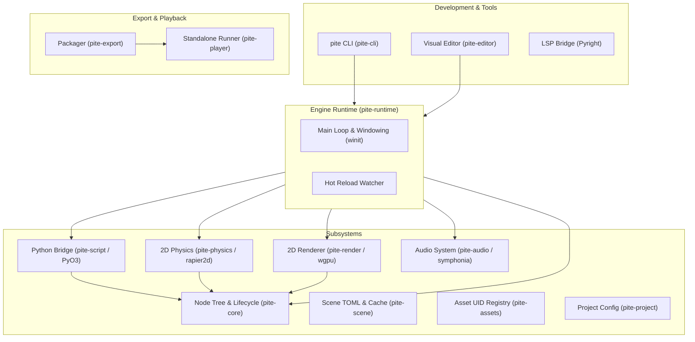
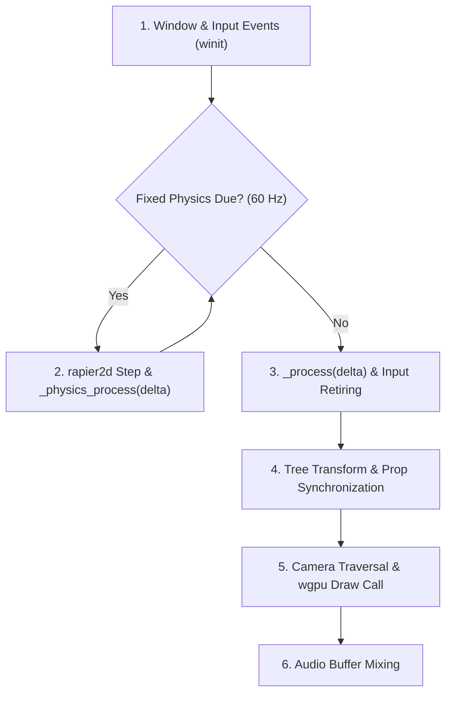

# Engine Architecture

Pite is built with a dual-layer architecture: a high-performance **Rust core** handling memory safety, rendering, audio, physics, and windowing, paired with an embedded **Python 3.12 scripting runtime** designed for gameplay logic and rapid iteration.

---

## Architectural Philosophy

Game development balances two distinct programming needs:

1. **System Performance**: Window management, GPU pipelines, audio mixing, collision math, and asset decoding need raw CPU speed, cache friendliness, and deterministic memory behavior. Rust is ideal for this foundation.
2. **Gameplay Decision-Making**: Game logic is largely decision-making—handling state transitions, player inputs, level objectives, and dialogue. Python provides dynamic ergonomics, concise syntax, and an expansive developer ecosystem.

Rather than building an interpreted engine or requiring developers to compile C++ or Rust for small script tweaks, Pite embeds CPython directly inside the Rust engine process using [PyO3](https://pyo3.rs/).

---

## Workspace Crates

The engine is structured as a modular Rust workspace consisting of 13 focused crates:

| Crate | Role |
| :---- | :--- |
| `pite` (`pite-cli`) | Unified command-line interface: `new`, `run`, `check`, `edit`, `export`, `toolchain`, `vendor`. |
| `pite-runtime` | Window creation (`winit`), the main execution loop, event polling, input forwarding, and hot reload orchestration. |
| `pite-core` | The hierarchical scene tree, `NodeId` handles, schema definitions, custom properties, and lifecycle signals. |
| `pite-script` | Embedded Python 3.12 bindings (PyO3), native `Vec2` math class, property accessors, and input state. |
| `pite-physics` | Pure-Rust 2D physics simulation powered by `rapier2d 0.36`, kinematic controller, and collision queries. |
| `pite-render` | 2D batch sprite and text renderer built directly on [wgpu](https://wgpu.rs/). |
| `pite-audio` | Audio engine decoding WAV, OGG Vorbis, MP3, and FLAC via `symphonia` and `cpal`, with silent simulation fallback. |
| `pite-scene` | Human-readable `.ptscn` TOML parsing, validation, byte-stable serialization, and binary disk cache. |
| `pite-assets` | Asset import pipeline, header validation, UID tracking (`assets.pite.toml`), and reference reconciliation. |
| `pite-project` | Project manifest loader (`pite.toml`), `res://` path resolver, and starter templates. |
| `pite-export` | Self-contained game bundler, standalone asset collection, and CPython runtime packager. |
| `pite-player` | Lean game runner binary without editor dependencies for distribution builds. |
| `pite-editor` | Integrated desktop editor built with `egui`/`eframe`, featuring a GPU viewport, tree view, inspector, and LSP client. |

---

## Execution Frame Loop

Each frame of a running game executes deterministically through `pite-runtime`:

### Input Event Collection
Window and hardware events are collected from the OS via `winit` and translated into engine input state (`pite.held`, `pite.pressed`, and physical mouse coordinates).

### Fixed Physics Simulation at 60 Hz
Physics runs on a fixed time accumulator at 60 Hz (`dt = 1/60`):
- Dynamic bodies and forces advance via `rapier2d`.
- Scripts defining `_physics_process(delta)` execute, allowing kinematic controllers like `CharacterBody2D` to call `move_and_slide()`.
- Contact flags (`is_on_floor`, `is_on_wall`, `is_on_ceiling`) and overlap events (`body_entered`) update.

### Variable Gameplay Frame
For each visual frame:
- The delta time `delta` (clamped to at most 0.1s to prevent spiral-of-death during pauses) passes to `_process(delta)` in attached Python scripts.
- Input edge states (`pressed` and `released`) clear at the end of the frame.

### Direct Property Synchronization
Script assignments such as `self.position.x += 10` or `self.texture = "res://…"` write directly into the Rust tree state without intermediary string lookups or end-of-frame reflection passes.

### Offscreen and Surface Rendering
The renderer traverses the node tree in scene-tree order:
- Cameras calculate view projections (`screen_to_world`).
- Sprite quads and text glyphs batch into vertex buffers.
- `wgpu` renders the scene directly to the surface (or into an offscreen texture for the editor viewport).

---

## Scripting Bridge and Memory Model

The scripting subsystem connects Python to the Rust core without compromising stability:

- **Direct Property Handles**: Vector math (`Vec2`) and transform properties operate via lightweight proxy handles. Writing `self.position = (100, 200)` alters the underlying node matrix in Rust immediately.
- **Node Descriptor Caching**: Declarative descriptors (`pite.child("Sprite")` and `pite.node("../Target")`) resolve on first access and cache their handle, avoiding tree lookups in tight loops.
- **Exception Isolation**: Python exceptions during `_ready` or `_process` are captured and formatted with stack traces in the engine console. The offending node is parked while the rest of the game and editor continue running safely.
- **Hot Reloading**: Modifying a `.py` script on disk causes the runtime to recompile the Python module, rebind methods to active node instances, preserve custom attributes (`__dict__`) and physics velocity, and resume playback without restarting the game.

---

## Assets and Scene Persistence

Pite maintains strict data guarantees across your filesystem:

- **Byte-Stable Serialization**: `.ptscn` files serialize properties in deterministic sorted order. Opening, saving, and closing a scene in the editor produces zero unintended git diffs.
- **Instance Preservation**: Instantiated sub-scenes (`[[instance]]`) remain modular references in TOML. Node overrides are stored as individual diffs rather than baking sub-trees into duplicate nodes.
- **Derived Binary Cache**: For instant boot times, Pite caches compiled scene binaries beside the source file in `_cache/<name>.<hash>.bin`. The TOML source remains authoritative; touching a `.ptscn` file automatically invalidates and rebuilds the cache.
- **UID Registry**: When files move on disk, `pite check --reimport-assets` uses content hashes recorded in `assets.pite.toml` to automatically rewrite `res://` references across all scene and script files.
