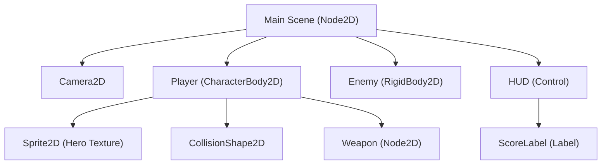

# Why Scene Tree?

Why Pite chose a hierarchical scene-tree architecture instead of an Entity Component System (ECS).

When developers build games in Rust, the community almost unanimously recommends an **Entity Component System (ECS)** architecture (seen in frameworks like Bevy or Specs). ECS stores components in contiguous memory arrays and runs systems as queries over those components.

Pite deliberately chooses a **Scene Tree** model instead. Here is why.

---

## 1. Games Are Naturally Hierarchical

Most video games are inherently spatial and relational:

- A **Player** node owns a **Sprite2D** and a **CollisionShape2D**.
- A **Gun** is attached to the player's hand; when the player moves or turns, the gun must automatically inherit that position and rotation.
- A **Camera2D** follows the player as a child node.
- A floating **HealthBar** stays positioned directly above an enemy's head.
- A **UI Canvas** contains buttons, labels, and icons aligned relative to containers.

In a scene tree, **parent-child coordinate inheritance is automatic**. Moving a parent node transforms all descendants naturally down the tree. 

In a pure ECS, expressing parent-child relationships requires building custom hierarchy components, tracking parent entities via IDs, and running explicit transform-propagation systems every frame to reconcile global matrices.



---

## 2. Scenes Are Nodes (Composability)

In Pite, there is no conceptual division between a "game world" and an "actor":

- A scene file (`player.ptscn`) is just a branch of nodes saved to disk.
- You can instantiate `player.ptscn` inside `level_1.ptscn` as a child node.
- You can instantiate `level_1.ptscn` inside a menu scene.

Instantiated sub-scenes remain modular references on disk. If you tune `player.ptscn`, every level containing a player automatically inherits the update without baking duplicate definitions. Property overrides are recorded cleanly as diffs (`node.prop = value`).

---

## 3. Python Ergonomics Match Object Trees

ECS works well when writing low-level data-parallel systems in languages with strong type systems like Rust or C++. However, ECS becomes clunky when bridged to high-level scripting languages like Python:

```python
# ECS style in Python: query-heavy and verbose
def update_player_system(world, delta):
    for entity, (pos, vel, controller) in world.query(Position, Velocity, PlayerController):
        if input.is_held("right"):
            vel.x = controller.speed
```

In contrast, Pite's scene tree maps 1:1 to standard Python object-oriented patterns:

```python
# Pite Scene Tree style: clean, intuitive, and self-contained
class Player(pite.CharacterBody2D):
    speed: float = 250.0

    def _physics_process(self, delta: float):
        if pite.held.right:
            self.velocity.x = self.speed
        self.move_and_slide()
```

Gameplay scripts attach directly to the node they control. Each node owns its state, lifecycle methods (`_ready`, `_process`), and signals (`body_entered`, `pressed`).

---

## 4. Visual Editing Requires Tree Representation

Game designers and artists think visually:

1. **Hierarchy View**: The editor's left panel displays your scene tree with clear drag-and-drop parenting, child reordering, and visibility controls.
2. **Inspector Mapping**: Selecting any node in the tree immediately reveals its properties, inherited classes, and script attachments in the inspector.
3. **Spatial Navigation**: Cross-node communication uses clear, human-readable node paths (`get_node("../ScoreLabel")` or `pite.node("../Target")`) rather than opaque entity IDs.

What you see in the visual editor matches your script structure and disk files.

---

## 5. Architectural Comparison

| Dimension | Scene Tree (Pite) | Entity Component System (ECS) |
| :-------- | :---------------- | :---------------------------- |
| **Mental Model** | Hierarchical, spatial, and object-oriented. | Relational database: entities are rows, components are columns. |
| **Coordinate Hierarchy** | Automatic through parent-child node transforms. | Requires explicit transform hierarchy systems and queries. |
| **Scripting Feel** | Intuitive class inheritance (`class Hero(pite.Node2D)`). | System loops, queries, and entity-ID lookups. |
| **Composability** | Scenes can be instantiated inside other scenes. | Prefabs or entity blueprints require custom instantiation logic. |
| **Target Sweet Spot** | 2D platformers, action games, RPGs, narrative, and arcade games. | Mass simulation (e.g. 50,000 homogeneous particles, flocking boids). |
| **Visual Tooling** | Direct 1:1 correspondence with the editor tree view. | Inspector requires custom query visualizers and archetype inspectors. |

For indie games, solo projects, game jams, and small-team productions, the developer velocity, readability, and mental clarity of a **Scene Tree** make game creation faster and much more enjoyable.
