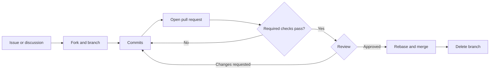

# How to create a pull request

This guide helps you to create PR to [the Pite repository](https://github.com/piteengine/pite). Following it helps you to do it faster and also helps maintainers to merge your PR faster.

Pite keeps a linear history: changes land on `main` as focused commits, and pull requests are merged with **Rebase and merge**. The commits inside a pull request are therefore as much a part of the review as the code.

## Before You Start

- **Find or open an issue.** Search existing issues first. If nothing matches, open one; the pull request template asks you to link it. Trivial fixes (typos, broken anchors) may go straight to a pull request, but describe the problem in the Summary section.
- **Discuss large changes first.** New subsystems, scene-format changes, and public API redesigns should start in [GitHub Discussions](https://github.com/piteengine/pite/discussions) so the design is agreed before code review.
- **Start with `good first issue` or `help wanted`.** Both labels mark work a maintainer has already scoped.
- **Set up the build.** Embedded scripting needs CPython 3.12 development headers, and Linux audio needs ALSA headers; the [Contributing Guide](../contributing.md) covers the environment variables and platform packages.
- **Build and test once before branching.** A green baseline makes CI failures unambiguous.

## Pull Request Lifecycle



## Prepare a Branch

Fork the repository, clone your fork, and keep `main` current from upstream:

```sh
git remote add upstream https://github.com/piteengine/pite.git
git fetch upstream
git switch main
git merge --ff-only upstream/main
```

Branch from `main`, never from a release tag or another feature branch. Name the branch `type/short-slug`, where `type` is the commit prefix and `slug` is two to four words:

- `feat/tilemap-brush-size`
- `fix/scene-cache-hash`
- `docs/pr-title-convention`
- `perf/render-texture-batching`

Keep one branch per change. If you need to touch an unrelated area, open a second branch instead of widening the first.

## Write Commits

- Follow [Conventional Commits](https://www.conventionalcommits.org/): `type(scope): summary`.
- Keep the type and scope lowercase, use the imperative mood, drop the trailing period, and keep the subject under 72 characters.
- Make one logical change per commit. Each commit should build and pass the fast checks on its own.
- Clean up the history before requesting review with `git rebase -i upstream/main`; fixups, `wip` commits, and debug prints should not reach review.
- Do not rewrite commits that someone has already reviewed without saying so in the pull request.

| Prefix     | Label            | Use for                                           |
| ---------- | ---------------- | ------------------------------------------------- |
| `feat`     | `type: feature`  | A new feature or engine capability                |
| `fix`      | `type: fix`      | A bug fix or patch                                |
| `docs`     | `type: docs`     | Documentation fixes and improvements              |
| `style`    | `type: style`    | Formatting, whitespace, or non-functional styling |
| `refactor` | `type: refactor` | Internal refactoring with no behavior change      |
| `perf`     | `type: perf`     | A performance improvement                         |
| `test`     | `type: test`     | New or improved tests                             |
| `chore`    | `type: chore`    | Maintenance, CI, or internal tooling              |
| `dep`      | `type: dep`      | Dependency updates, usually from Dependabot       |
| `a11y`     | `type: a11y`     | An accessibility improvement                      |

`dep` and `a11y` extend the Conventional Commits set; both are accepted commit prefixes in this repository. The GitHub label for features is `type: feature`, while the commit prefix stays `feat`, matching git history and the specification.

## Open the Pull Request

Target `main` and use the title format `Type(Scope): Summary`:

- Capitalize the type and scope, then write the summary in sentence case.
- Set the scope to the subsystem you touched, using the names in the mapping below (`Editor`, `Scene`, `Render`, `CLI`, and so on). Omit the scope only when the change genuinely spans several subsystems.
- Keep the title specific enough to stand alone in a changelog.

```text
Commit:     refactor(editor): split app.rs into dedicated submodules
PR title:   Refactor(Editor): Split `app.rs` into dedicated submodules
```

Fill the body from the [pull request template](https://github.com/piteengine/pite/blob/main/.github/PULL_REQUEST_TEMPLATE.md) and keep its HTML comments in place; they carry instructions for the next contributor.

- Link the issue with `Closes #123` or `Fixes #123`, one line per issue.
- Attach a screenshot or short recording for editor, rendering, or UI changes.
- Include the failing command and output for bug fixes, and the new command and output for CLI changes.
- Open a draft pull request when you want early feedback; mark it ready only when the checks pass and the checklist is complete.

## Fill the Template

### Summary

State what changed, why it changed, and any architectural decision a reviewer should know about. Replace the template paragraph rather than appending to it.

### Related Issues

Use `Closes #X` to close an issue on merge and `Fixes #X` for a defect. Linking another pull request is allowed; plain `#X` mentions do not close anything.

### Type and Scope

Tick exactly one type. Tick every subsystem the change touches; the boxes map to labels a maintainer applies.

| Template checkbox            | Label                          |
| ---------------------------- | ------------------------------ |
| Editor                       | `subsystem: editor`            |
| Command-line interface (CLI) | `subsystem: cli`               |
| Core & Scene Tree            | `subsystem: scene`             |
| Scripting & Python Bridge    | `subsystem: scripting`         |
| Physics                      | `subsystem: physics`           |
| Render                       | `subsystem: render`            |
| Audio                        | `subsystem: audio`             |
| Assets & Manifest            | `subsystem: manifest & assets` |
| Export & Player Bundle       | `subsystem: export`            |
| Engine Runtime               | `subsystem: runtime`           |
| Documentation & Governance   | No label; use `type: docs`     |

Documentation and governance pull requests carry `type: docs` and no subsystem label.

### Verification and Testing

Run the commands in the section and tick the boxes only when they pass locally. Paste output when a check is expected to fail for a known reason.

### Quality and Safety Checklist

Read every line. `unsafe` blocks need a `// SAFETY:` comment, public API or scene-format changes need documentation updates, and accessibility impact applies to UI, CLI, and documentation changes.

## Continuous Integration

Every pull request runs the same suite, split into parallel jobs:

- **Format** — `cargo fmt --all -- --check` — rustfmt drift.
- **Markdown** — `npx markdownlint-cli2` — heading structure, table alignment, and link style across tracked Markdown.
- **Build** — `cargo build --workspace --locked` — compilation, lockfile drift, and the PyPI stub version matching the workspace.
- **Tests** — `cargo test --workspace --locked` — unit and integration tests.
- **LSP Smoke** — `PITE_LSP_SMOKE=1 cargo test -p pite-editor --lib live_pyright_smoke` — a live pyright session against the pinned `1.1.411` server.
- **Export Smoke** — `PITE_BUNDLE_SMOKE=1 cargo test -p pite-export --lib` — a real CPython download and bundle.
- **Projects Check** — `bash scripts/check-examples.sh` — `pite check` on every bundled project.

Run the fast jobs locally before pushing:

```sh
cargo fmt --all -- --check
npx markdownlint-cli2
cargo build --workspace --locked
cargo test --workspace --locked
bash scripts/check-examples.sh
```

The two smoke jobs download toolchains and are slow; run them locally when your change touches the language server, export, or the Python bundle. The documentation site builds after merge rather than per pull request, so run `python3 scripts/update-nav.py --check` and `zensical build --clean` yourself when you edit `zensical.toml` or anything under `docs/`.

## Review

- Outside contributors need one maintainer approval plus all required checks. Maintainers may self-merge their own pull requests once checks pass.
- Only **Rebase and merge** is enabled. Merge commits are rejected and history stays linear.
- Because rebase merge preserves individual commits, squash fixups and reword subjects before the final approval.
- Re-request review after pushing changes, and leave conversations for the reviewer to resolve.
- Rebase onto `main` when the branch falls behind, then push with `git push --force-with-lease`.
- A reviewer may ask for a change to be split into separate pull requests; this keeps review and rollback cheap.

## Merge and Cleanup

1. Confirm the commits read as intended, since rebase merge keeps them verbatim.
2. Merge with **Rebase and merge**.
3. Delete the branch in the GitHub interface and locally with `git push origin --delete <branch>`.
4. Sync your `main` with `git fetch upstream && git merge --ff-only upstream/main`.
5. Add a user-visible entry under `Unreleased` in [the changelog](../changelog.md); a maintainer can add it at merge time if you forget.

## Example Pull Request

````markdown
## Summary

Adds a brush-size control to the tilemap editor. The brush paints a square of
tiles around the cursor, and the size persists for the editing session. Building
large rooms previously required clicking one tile at a time.

## Related Issues

- Closes #412

## Type and Scope

### Type of Change

- [x] `feat`: A new feature or engine capability

### Subsystems Affected

- [x] Editor

## Verification and Testing

```sh
cargo fmt --all -- --check
cargo build --workspace --locked
cargo test --workspace --locked
bash scripts/check-examples.sh
```

- [x] All tests pass locally
- [x] Formatting checks pass with zero warnings
- [x] Clean build with no compiler warnings

## Quality and Safety Checklist

- [x] Commits adhere to Conventional Commits specification
- [x] Zero credentials, secrets, or platform tokens committed
- [x] No hardcoded local paths or generated cache files staged
- [x] Any `unsafe` block includes an explicit `// SAFETY:` rationale
- [x] Documentation updated if public API, CLI flags, or scene format changed
- [x] Accessibility impact considered for UI, CLI, or documentation changes
````

The example works because the title names one subsystem, the body links the issue, the checklist is complete, and the commits stay small enough to read individually.
