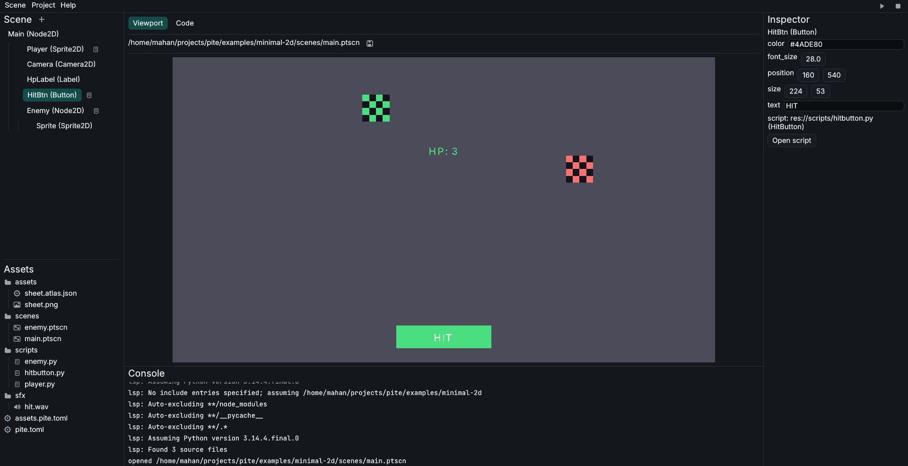

# Editor Guide

A comprehensive guide to Pite's integrated visual scene editor and code environment.

Pite provides an all-in-one desktop editor that combines an interactive scene tree, a real-time GPU viewport, an inspector for node properties, an asset file manager, and an embedded code editor with full Python language server support.



Launch the editor from your terminal by running:

```sh title="Terminal"
pite
```

*(Or explicitly with `pite edit [path/to/scene.ptscn]`).*

---

## Editor Interface

The workspace is organized into five functional regions:

- **Top Bar**: Menu bar containing `Scene`, `Project`, and `Help` menus, alongside **Play (`▶`)** and **Stop (`■`)** buttons.
- **Viewport** *(Center)*: Displays the real-time rendered scene framed at your project's design resolution.
- **Code Tab** *(Center)*: Built-in code editor for writing Python scripts with syntax highlighting and LSP completion.
- **Scene Tree** *(Top-Left)*: Hierarchical tree showing all nodes in the active scene.
- **Assets Panel** *(Bottom-Left)*: Full-featured project file browser and asset manager.
- **Inspector** *(Right)*: Contextual property inspector with inheritance-grouped properties.
- **Console** *(Bottom)*: Real-time scrolling output for engine logs, print statements, and error traces.

---

## Viewport and Playtesting

The **Viewport** renders your game using the same camera and rendering pipeline as the standalone game runner:

- **Resolution Scaling**: The viewport automatically contain-fits your game's design resolution (configured in `pite.toml`) into the available panel space, preserving your aspect ratio with clean letterboxing.
- **Playtesting**: Press the **Play (`▶`)** icon or ++ctrl+r++ / ++f5++ to start gameplay simulation directly in the viewport. Press **Stop (`■`)** or ++ctrl+r++ again to halt playback.

!!! Note "Input Forwarding"
    Keyboard and mouse events are routed to your running scene whenever the cursor is inside the viewport area. Moving the mouse outside the viewport gives priority back to the code editor and global shortcuts.

---

## Scene Tree

The **Scene Tree** displays the node hierarchy of your current scene, complete with Phosphor icons and color coding per category (2D in blue, physics in teal, UI in green, and timers in gold).

### Adding Nodes

Click the **+** (Add) button in the Scene Tree header or right-click any node and choose **Add Child Node…** to open the creation dialog:

- **Inheritance Tree & Search**: Browse the Godot-style inheritance tree or use the instant search bar to find node types quickly.
- **Node Descriptions**: Selecting a type shows its purpose, inherited capabilities, and typical use cases.
- **Placement**: The newly created node is automatically inserted directly under the currently selected node (or root), expanding the parent branch.

### Node Instantiation

To instantiate another `.ptscn` scene as a sub-tree:

- Press ++ctrl+shift+a++ or choose **Instantiate Child Scene…** from the context menu to pick a scene file.
- Or drag a `.ptscn` file directly from the Assets panel into the Scene Tree.

### Reordering and Parenting

The Scene Tree supports drag-and-drop with activation thresholds to prevent accidental drags:

- **3-2 Drop Zones**:
    - **Center band**: Drop onto the center of a row to reparent as a child (indicated by a teal bounding box).
    - **Bottom band**: Drop near the bottom edge to insert as a sibling immediately after.
    - **Top edge (first child)**: Drop on the top edge of the first child to insert before it.
- **Drag Preview Badge**: A floating preview card follows the cursor, showing the dragged node's icon, name, and destination target.

### Node Management

Right-click any node in the tree or use keyboard shortcuts:

- **Duplicate** (++ctrl+d++): Recursively clones the node, its entire subtree, and all overridden properties.
- **Rename** (++f2++): Opens an in-place rename dialog.
- **Delete** (++del++): Removes the node and its children (the root node is protected).
- **Move Up / Move Down**: Reorders siblings in the tree.
- **Attach Script**: Choose **Attach Script…** or drag any `.py` file from the Assets panel onto the node.

---

## Property Inspector

Selecting any node in the Scene Tree populates the **Inspector** on the right with an inheritance-grouped layout reflecting the engine's class hierarchy:

```text
▼ CharacterBody2D
    velocity: [0.0, 0.0]
    up_direction: [0.0, -1.0]
▼ Node2D
    position: [640.0, 360.0]
    rotation: 0.0
    scale: [1.0, 1.0]
▼ Node
    name: "Player"
```

### Inheritance Sections and Revert Buttons

- **Inheritance Grouping**: Properties are organized in collapsible groups corresponding to each ancestor class (e.g. `CharacterBody2D` inherits from `Node2D`, which inherits from `Node`).
- **Revert to Default**: Overridden properties display a subtle revert button next to their label, allowing you to reset any field back to its engine default with one click.
- **Drag-and-Drop Assignment**: Drag images (`.png`) or atlases (`.atlas.json`) from the Assets panel directly onto texture and atlas fields in the Inspector.

### Editable Property Types

Pite maps engine types directly to interactive controls:

| Property Type              | Editor Control    | Behavior                                                  |
| :------------------------- | :---------------- | :-------------------------------------------------------- |
| **Floating point** (`Num`) | DragValue         | Click and drag horizontally to tune; double-click to type |
| **Integer** (`Int`)        | Integer DragValue | Step values or direct integer entry                       |
| **Text** (`Str`)           | Text Edit         | Direct single-line string input                           |
| **Boolean** (`Bool`)       | Checkbox          | Toggle on / off                                           |
| **Vector** (`Vec2`)        | Dual DragValues   | Independent `x` and `y` coordinate fields                 |

### Script Attachments

The script attachment section at the bottom displays:

- **Path**: The `res://` path pointing to the script file (always relative to the project root).
- **Class**: The name of the Python class inside the script.
- **Open Script**: Switches the central panel to the **Code** tab and loads the attached file.
- **Remove Script**: Detaches the script from the node.

---

## Assets Panel File Manager

The **Assets Panel** is a full-featured project file browser:

- **Directory Tree**: Folders are sorted first alphabetically with empty folders preserved, followed by files alphabetically. Single-click selects an asset with highlight; double-click opens files (or toggles folders).
- **Header Actions**: Quick **+ File** and **+ Folder** buttons open modal dialogs with starter templates:
    - **Script (`.py`)**: Generates a starter script inheriting `pite.Node`.
    - **Scene (`.ptscn`)**: Scaffolds a minimal valid scene with a root node.
    - **Empty File / Folder**: Creates a blank item.
- **Context Menu & Shortcuts**:
    - **Cut** (++ctrl+x++), **Copy** (++ctrl+c++), **Paste** (++ctrl+v++)
    - **Duplicate** (++ctrl+d++)
    - **Rename** (++f2++): Renames the asset on disk and automatically rewrites references across scenes and scripts via `pite_assets::apply_renames`.
    - **Delete** (++del++): Deletes the item with a confirmation modal.
    - **Copy Relative Path (`res://…`)** and **Copy Absolute Path**
    - **Show in File Manager**: Reveals the item in your operating system's native file explorer.
- **Drag-and-Drop Ingestion**: Drag files or folders directly from your operating system into the Assets panel. Pite copies them to the target directory, applies collision suffixes (`file (1).ext`) if needed, and triggers an asset reimport.
- **Internal Moving**: Dragging files or folders onto other directories moves them on disk with cycle protection and automatic reference updates.
- **Cross-Panel Dragging**: Drag `.py` scripts onto Scene Tree nodes to attach them; drag `.png` or `.atlas.json` onto Inspector fields to assign properties.

---

## Code Editor and Autocomplete

Clicking any script in the Assets browser or choosing **Open Script** switches the central view to the **Code** tab.

### Features

- **Syntax Highlighting**: Colors Python keywords, strings, function definitions, numbers, and comments.
- **Error Gutter**: Line numbers line the left margin. Lines encountering runtime errors or syntax issues display diagnostic badges with hover tooltips.
- **Live Code Reload**: Saving a script (++ctrl+s++) while the game is playing updates logic in real time via hot reloading.

### Language Server (Pyright)

The editor integrates with Pyright using the Language Server Protocol (LSP) to provide intelligent autocomplete and type checking:

```sh title="Terminal"
pip install "pyright==1.1.411"
```

When Pyright is available on your system `PATH`:

- **Autocomplete**: As you type, suggestions appear in a contextual popup. Press ++ctrl+space++ to trigger completion anywhere, and ++enter++ to accept.
- **Signature Help**: Typing an opening parenthesis `(` displays function parameters and docstrings.
- **Type Hover**: Press ++ctrl+h++ over any variable or method to view type signatures.
- **Engine Stubs**: Pite bundles complete type stubs (`pite.pyi`), enabling autocompletion for all engine classes, properties, and signals without extra configuration.

---

## Project Settings Dialog

Open **Project > Project Settings…** to configure project metadata without editing TOML files manually:

- **Project Metadata**: Edit project `name`, `author`, `main_scene`, and `icon`.
- **Display Resolution**: Adjust `window_width` and `window_height`. The viewport updates its aspect framing immediately upon saving.
- **Export Inclusions**: Add non-code files or assets that must be included in exported bundles.

Clicking **Save** validates the fields and rewrites `pite.toml` cleanly.

---

## Keyboard Shortcuts

| Shortcut                   | Action                              | Scope                     |
| :------------------------- | :---------------------------------- | :------------------------ |
| ++ctrl+s++                 | Save current scene or script        | Global                    |
| ++ctrl+shift+s++           | Save Scene As…                      | Global                    |
| ++ctrl+o++                 | Open Scene file                     | Global                    |
| ++ctrl+n++                 | New Scene                           | Global                    |
| ++ctrl+r++ / ++f5++        | Play / Stop simulation              | Global                    |
| ++ctrl+q++                 | Quit Pite Editor                    | Global                    |
| ++ctrl+d++                 | Duplicate node / Duplicate asset    | Scene Tree / Assets Panel |
| ++f2++                     | Rename node / Rename asset          | Scene Tree / Assets Panel |
| ++ctrl+shift+a++           | Instantiate Child Scene…            | Scene Tree                |
| ++del++                    | Delete selected node / Delete asset | Scene Tree / Assets Panel |
| ++ctrl+x++ / ++c++ / ++v++ | Cut / Copy / Paste asset            | Assets Panel              |
| ++ctrl+space++             | Force LSP autocomplete popup        | Code Tab                  |
| ++ctrl+h++                 | Show type hover info                | Code Tab                  |
| ++esc++                    | Dismiss autocomplete popup          | Code Tab                  |
