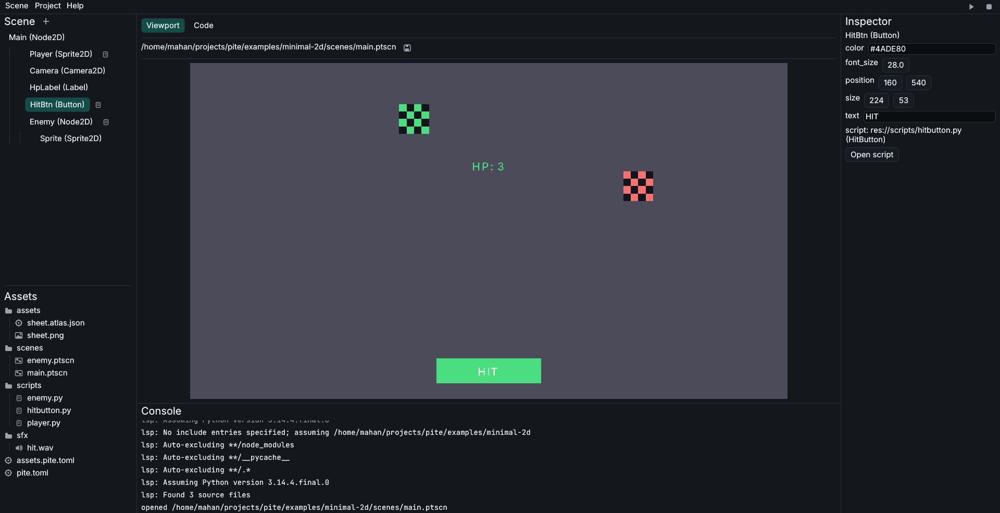

# Pite [](https://github.com/piteengine/pite/releases/latest)

**A game engine that's handy to use, to change, to own.**

Pite is a **2D** game engine built to be **easy to learn and to use**, shaped around **what you know**: Python for scripting, interactive visual editor, node trees, single-command exports; While giving you speed and reliability under the hood.

[Get started](getting-started/install){ .md-button .md-button--primary }
[View on GitHub :fontawesome-brands-github:](https://github.com/piteengine/pite){ .md-button }



## Install

=== "Linux / macOS"
    Install script installs Pite engine on your device with one command from GitHub using:

    ```sh title="Terminal"
    curl -fsSL https://raw.githubusercontent.com/piteengine/pite/main/install.sh | sh
    ```

=== "Windows"
    Install script installs Pite engine on your device with one command from GitHub:

    ```pwsh title="PowerShell"
    irm https://raw.githubusercontent.com/piteengine/pite/main/install.ps1 | iex
    ```

=== "Cargo"
    Build from source is available from [crates.io](https://crates.io/crates/pite):
    ```sh title="Terminal"
    cargo install pite
    ```

    !!! Note
        Cargo installation method means build from source and has system requirements:

        - **Python 3.12** with development headers (e.g. `python3.12-dev` on Debian/Ubuntu, or Python 3.12 on macOS/Windows).
        - **ALSA headers** on Linux: `sudo apt-get install libasound2-dev pkg-config`.

More installation methods and details are available in [installation page](getting-started/install).

## Quickstart

Once Pite is installed, run these three commands in terminal to create a new project and open the editor:

```sh
pite new hello-pite --template minimal-2d
cd hello-pite
pite
```

Press the `▶` play button in top-right corner of editor to test the template game! Also `pite run` inside project folder starts the game directly.

## Why Pite?

<div class="grid cards" markdown>

- :material-language-python: **Python-first**
    Script in a high-level language you already know.

- :material-cube-outline: **Scene tree, not ECS**
    Readable, editable, source-controlled scenes.

- :material-package-variant-closed: **~20 MB exports**
    Hello-world on Windows[^1]. No Python install needed.

- :material-hammer-wrench: **Real editor**
    Viewport, inspector, code completion, error gutter.

</div>

## Example Script

```py title="scripts/player.py"
import pite

class Player(pite.Node2D):
    speed: float = 200.0

    def _process(self, delta: float):
        if pite.held.right:
            self.position.x += self.speed * delta
```

## FAQ

??? Question "What platforms are supported in Pite now?"
    Pite currently supports **Windows, Linux, macOS** (major desktop platforms) as development environment and target. It means you can make games in one of these platforms and then you can export it to all of them.

??? Question "Do I have to install Rust and Python to export games?"
    **No**, Pite fetches Python and engine binary from the internet at export time (and stores them inside `~/.cache/pite/toolchains`). But you must have Python installed on your device **to run games inside editor.**

    For more details on Python bundling and runtime resolution, see the [Export Guide](guides/export.md).

[^1]: Measured on the `minimal-2d` template with Pite v0.3.0. ~20 MB on Window, ~36 MB on macOS, ~52 MB on Linux. the difference comes from the *Python Standard Library* needing different dynamic linkers on each platform.
